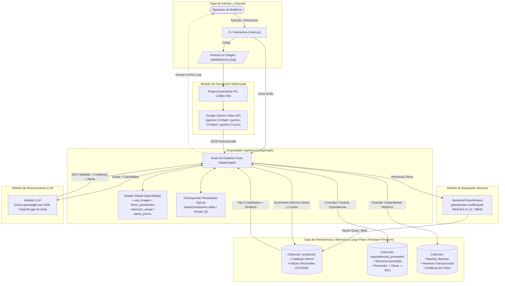
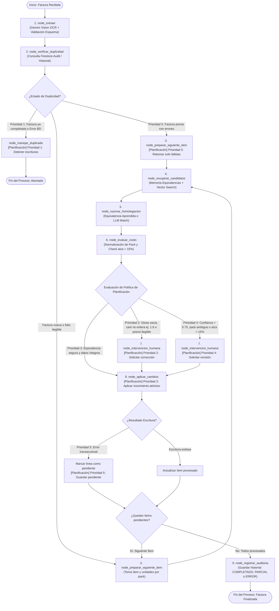

# Agente Inteligente de Homologación de Facturas e Inventario (Botillería)

## 1. Problema de Negocio y Solución

En el rubro de las botillerías y comercializadoras de licores, las facturas emitidas por distribuidores mayoristas emplean glosas con abreviaturas comerciales informales (ej. `"mst 35 750"`, `"cerv cor 355 pack6"`, `"pis cap 30"`), empaques por bulto/pack, calibres variados y estructuras heterogéneas. La digitación manual de estas facturas genera altos costos operativos, lentitud en la reposición y errores en el stock y costos.

**Nuestra Solución** es desarrollar un **Agente Funcional con LangGraph** que orquesta herramientas de percepción multimodal, búsqueda semántica vectorial, razonamiento estructurado con LLM y persistencia en Firestore, con soporte para **memoria de corto y largo plazo** y un ciclo de **revisión humana supervisada (*Human-in-the-Loop*)** ante anomalías de precios, datos ilegibles o productos nuevos.

## 2. Arquitectura General del Sistema

El siguiente diagrama detalla la orquestación entre la interfaz de usuario, el orquestador LangGraph, los modelos de inteligencia artificial y la capa de almacenamiento en la nube:




## 3. Planificación Explícita y Política de Decisión Adaptativa

El grafo de estados finitos del agente modela una planificación base estructurada: **extraer, verificar, recuperar, razonar, evaluar y escribir**, en donde el agente formaliza y explicita esta toma de decisiones mediante una **Política de Prioridades Operativas** (`src/agent/planning_policy.py`).

Para visibilizar en consola cada decisión adaptativa en tiempo real y eliminar bloques de texto plano no diferenciado, el agente emplea la librería **`colorist`**, destacando el prefijo **`[Planificación]`** con fondo Cyan (`BgColor.CYAN`) y el texto de la prioridad en color Cyan (`Color.CYAN`), registrando además la regla en `state["politica_planificacion"]` y en la bitácora transaccional.

### 3.1. Tabla Formal de la Política de Planificación

| Prioridad | Regla | Condición Operativa | Acción del Agente |
| :---: | :--- | :--- | :--- |
| **1** | **Control de Duplicidad e Integridad de Proceso** | Falla la verificación de duplicidad (factura ya completada o error al consultar Firestore). | **Detener las escrituras** y abortar el flujo para proteger el inventario. |
| **2** | **Integridad de Datos** | Faltan datos necesarios (glosa vacía, cantidad no entera como `1.6` o precio unitario ilegible). | **Solicitar corrección** al operador humano (*Human-in-the-Loop*) sin asumir valores arbitrarios. |
| **3** | **Ejecución Segura** | Hay equivalencia segura (memoria aprendida o confianza heurística $\ge 0.75$) y datos válidos. | **Aplicar el movimiento** atómico (actualizar stock y movimiento) sin fricción. |
| **4** | **Gestión de Incertidumbre y Variación de Costo** | Hay ambigüedad (confianza heurística $< 0.75$, pack ambiguo) o aumento de costo ($>15\%$). | **Solicitar revisión** y decisión humana con candidatos recuperados antes de escribir. |
| **5** | **Resiliencia e Idempotencia ante Fallos** | Falló un movimiento transaccional durante el procesamiento de la factura. | **Guardarlo como pendiente** y reintentar de forma selectiva sin repetir las líneas exitosas. |


### 3.2. Diagrama de Estados y Flujo de Decisión Adaptativa (LangGraph)

El siguiente diagrama detalla cómo las 5 prioridades de planificación gobiernan la máquina de estados cíclica:




### 3.3. Ejemplos Concretos de Ejecución por Prioridad (Salidas en Consola)

A continuación se muestran ejemplos reales del formato visual emitido por el agente mediante `colorist`:

#### Ejemplo Prioridad 1 (Control de Duplicidad e Integridad):
```text
[Agente - Verificación] Comprobando duplicidad para folio '7700' de 'DISTRIBUIDORA CENTRAL'...
 -> La factura folio '7700' de 'DISTRIBUIDORA CENTRAL' ya fue registrada y completada previamente.
[Planificación] Prioridad 1 (Control de Duplicidad e Integridad) -> Factura folio '7700' de 'DISTRIBUIDORA CENTRAL' ya completada previamente. Deteniendo escrituras.
[Agente - Control] ADVERTENCIA: Proceso abortado para evitar duplicar stock. Factura folio '7700' registrada el 2026-10-28.
```

#### Ejemplo Prioridad 2 (Integridad de Datos — Cantidad no entera):
```text
--- Iniciando evaluación de ítem [L1]: 'Pisco Mistral 35' (Cantidad: 1.6, Unidades/Pack: 1 u/pack) ---
[Planificación] Prioridad 2 (Integridad de Datos) -> Faltan datos requeridos en el ítem: cantidad (no es entero: 1.6). Solicitando corrección al operador.
[HUMAN-IN-THE-LOOP - PAUSA LANGGRAPH] Se requiere decisión del operador:
 [AVISO] Campos ilegibles o incompletos detectados: cantidad (no es entero: 1.6)
```

#### Ejemplo Prioridad 3 (Ejecución Segura — Auto-homologación):
```text
--- Iniciando evaluación de ítem [L1]: 'CERV CORONA 355 PACK6' (Cantidad: 2, Unidades/Pack: 6 u/pack) ---
[Agente - Retrieval Semántico] Buscando candidatos para 'CERV CORONA 355 PACK6'...
 -> Candidatos recuperados: CER-COR-355 (Cerveza Corona 355cc)
[Agente - Razonamiento LLM] Evaluando homologación...
 -> Decisión de homologación: SKU=CER-COR-355 (Confianza=0.95) | Motivo: Match exacto
[Planificación] Prioridad 3 (Ejecución Segura) -> Equivalencia segura validada para 'CERV CORONA 355 PACK6' -> SKU 'CER-COR-355' (Confianza: 0.95) y datos íntegros. Aplicando movimiento atómico.
[Agente - Escritura] Stock de 'CER-COR-355' actualizado atómicamente de 20 a 32 unidades.
```

#### Ejemplo Prioridad 4 (Gestión de Incertidumbre o Alza de Costo):
```text
--- Iniciando evaluación de ítem [L1]: 'MST NOBLE 35 BOT 750' (Cantidad: 2, Unidades/Pack: 6 u/pack) ---
[Agente - Retrieval Semántico] Buscando candidatos para 'MST NOBLE 35 BOT 750'...
 -> Candidatos recuperados: PIS-CAP-35 (Pisco Capel 35°), PIS-MIS-35-750 (Pisco Mistral Añejado 35°)
[Agente - Razonamiento LLM] Evaluando homologación...
 -> Decisión de homologación: SKU=None (Confianza=0.00) | Motivo: Glosa abreviada requiere confirmación humana.
[Planificación] Prioridad 4 (Gestión de Incertidumbre y Costos) -> Ambigüedad en precio/unidades de pack; No se encontró coincidencia en catálogo. Solicitando revisión humana.
```

#### Ejemplo Prioridad 5 (Resiliencia e Idempotencia ante Fallos):
```text
[Planificación] Prioridad 5 (Resiliencia e Idempotencia) -> Falló auto-escritura de stock [L2] (Fallo transitorio simulado en Firestore). Guardado como pendiente (ERROR_ESCRITURA) para reintento selectivo.
...
[Agente - Verificación] Comprobando duplicidad para folio '7700' de 'DISTRIBUIDORA CENTRAL'...
 -> La factura folio '7700' tiene un registro previo en estado 'COMPLETADO_CON_ERRORES' (ID: AUD-0001). Se retomarán solo las líneas fallidas.
 -> Reintento parcial selectivo: se omiten 2 línea(s) exitosa(s) y se procesarán 1 línea(s) fallida(s)/pendiente(s).
[Planificación] Prioridad 5 (Resiliencia e Idempotencia) -> Factura previa en estado 'REINTENTO_CON_ERRORES'. Retomando únicamente 1 línea(s) fallida(s), conservando 2 línea(s) exitosa(s) sin repetir escrituras.
```


## 4. Catálogo de Herramientas (*Agent Tools*) y Reglas de Validación

El agente dispone de **11 herramientas formales** construidas bajo el estándar `@tool` de LangChain:

| Tipo | Herramienta | Archivo Fuente | Descripción |
| :---: | :--- | :--- | :--- |
| **Consulta** | `extraer_factura_desde_imagen` | `src/tools/query_tools.py` | Extrae proveedor, folio e ítems (glosa, formato, cantidad, unidades por pack y precio) usando Gemini Vision. |
| **Consulta** | `consultar_duplicidad_factura` | `src/tools/query_tools.py` | Verifica en Firestore si el folio existe, diferenciando `VERIFICADA_NUEVA`, `DUPLICADA` (solo si está `COMPLETADO`), `REINTENTO_CON_ERRORES` (`COMPLETADO_CON_ERRORES`), `FOLIO_ILEGIBLE` y `ERROR_CONSULTA`. |
| **Consulta** | `buscar_candidatos_vectoriales` | `src/tools/query_tools.py` | Búsqueda semántica (Top 3) mediante distancia coseno en Firestore, calculando `similitud_vectorial`. |
| **Consulta** | `consultar_producto_por_sku` | `src/tools/query_tools.py` | Inspecciona stock, costos y precios actuales de un producto en Firestore. |
| **Consulta** | `consultar_equivalencia_proveedor` | `src/tools/query_tools.py` | Recupera equivalencias históricas aprobadas (`proveedor + glosa -> SKU`) desde `equivalencias_proveedor` para auto-homologar en futuras facturas. |
| **Razonamiento** | `razonar_homologacion` | `src/tools/reasoning_tools.py` | Razona sobre abreviaturas comerciales, valida que el SKU pertenezca a los candidatos y calcula una única vez la puntuación heurística de confianza con la similitud vectorial. |
| **Razonamiento** | `evaluar_variacion_costo` | `src/tools/reasoning_tools.py` | Detecta aumentos abruptos de costo ($>15\%$) para sugerir ajustes al precio de venta. |
| **Escritura** | `actualizar_stock_y_costo` | `src/tools/write_tools.py` | Incrementa atómicamente el stock (`firestore.Increment`) y registra el movimiento (`proveedor + folio + línea`) en `movimientos_inventario` dentro de una misma transacción. |
| **Escritura** | `registrar_nuevo_producto` | `src/tools/write_tools.py` | Da de alta un SKU nuevo con su vector de 384d y registra su movimiento (`proveedor + folio + línea`) en la misma transacción atómica. |
| **Escritura** | `registrar_auditoria_factura` | `src/tools/write_tools.py` | Guarda o actualiza el comprobante transaccional en la colección `historial_facturas`. |
| **Escritura** | `guardar_equivalencia_proveedor` | `src/tools/write_tools.py` | Persiste en `equivalencias_proveedor` la equivalencia aprobada entre `proveedor`, `glosa` y `SKU`. |

### Controles de Robustez Implementados
* **Control de Duplicidad, Reintento Selectivo y Fallos de Consulta:** Si una factura previa ya está `COMPLETADO`, se bloquea como duplicada (`DUPLICADA`); si quedó en `COMPLETADO_CON_ERRORES`, activa `REINTENTO_CON_ERRORES` para **omitir las líneas exitosas y retomar únicamente las líneas fallidas**; si el folio es ilegible (`FOLIO_ILEGIBLE`), continúa; y si falla la consulta a Firestore (`ERROR_CONSULTA`), aborta de forma segura con estado `ERROR`.
* **Idempotencia Transaccional por Línea (`proveedor + folio + línea`):** El grafo envía siempre un `id_operacion` canónico (`PROVEEDOR::FOLIO::L<N>`) a todas las escrituras. Stock y movimiento (`movimientos_inventario`) se persisten en una **misma transacción de Firestore**, soportando múltiples líneas del mismo SKU en una factura y folios iguales de distintos proveedores sin duplicar stock en reintentos.
* **Revisión Humana Mejorada y Aprendizaje de Equivalencias (*Human-in-the-Loop*):** Ante baja confianza ($<0.75$), solicitud de revisión o datos ilegibles, `node_intervencion_humana` muestra los candidatos recuperados con su similitud y costo actual, permitiendo **4 acciones operativas** sin generar duplicados en el catálogo: **(1)** confirmar uno de los candidatos, **(2)** buscar en el catálogo por texto o ingresar otro SKU existente validado en Firestore, **(3)** crear un producto nuevo, o **(4)** omitir el ítem (además de pausar la sesión en SQLite). Al confirmar o dar de alta un SKU para una glosa legible, la relación `proveedor + glosa -> SKU` queda guardada en `equivalencias_proveedor` para homologarse automáticamente en facturas futuras.
* **Normalización de Costos y Manejo Riguroso de Packs:**
  * **Distinción Explícita de Costos:** Se diferencia formalmente entre precio por pack (`POR_PACK`) y costo unitario individual (`POR_UNIDAD`). Si el valor facturado corresponde a un bulto, el sistema normaliza el costo unitario como `precio_pack / unidades_pack` antes de compararlo en `evaluar_variacion_costo` o persistirlo en `productos/{sku}`.
    * *Ejemplo concreto:* Para 2 packs comprados de 6 unidades a un precio de \$12.000 por pack, el sistema ingresa **12 unidades de stock** (`2 * 6`) y almacena **\$2.000 como costo unitario** individual (`$12.000 / 6`), comparándolo contra el catálogo sin disparar falsas alarmas de incremento excesivo.
  * **Detección y Resolución de Ambigüedades:** Si el precio de un pack es ambiguo, el agente lo compara automáticamente con el costo histórico del catálogo (resolviéndolo si coincide con una de las hipótesis dentro del margen de variación). De no existir catálogo previo o ser inconcluyente, delega la decisión a revisión humana (*Human-in-the-Loop*).
  * **Validación Estricta de Unidades por Bulto:** Se eliminó cualquier reemplazo silencioso por `1` (`or 1`) en bultos o packs. Si una glosa o formato evidencia un empaque múltiple pero sus unidades no son legibles o son inválidas, el ítem se clasifica con campo ilegible (`"unidades por pack (bulto detectado sin unidades legibles)"`) y se desvía a revisión humana para proteger la integridad del inventario.
* **Fortalecimiento del Manejo de Errores y Validación Estricta:**
  * **Esquema Pydantic de Extracción:** Los datos multimodales se validan contra `FacturaExtraidaSchema` y `ItemFacturaExtraido` (encabezado, lista de ítems, cantidades y precios), tipando estrictamente cada atributo.
  * **Distinción de Documentos sin Productos vs Fallo de Extracción:** Si una extracción no contiene ítems pero cuenta con encabezado formal de factura, se registra como `PENDIENTE_REVISION` en lugar de marcarse erróneamente como `COMPLETADO`; si la imagen es ilegible o el OCR falla por completo, se cataloga como `ERROR_EXTRACCION`. Ambos estados pertenecen a `_ESTADOS_REINTENTABLES`, por lo que `consultar_duplicidad_factura` jamás los bloquea como duplicados y permite su reintento o resolución manual.
  * **Rechazo Estricto de Cantidades No Enteras (Cero Redondeo Silencioso):** La función `_parsear_entero_positivo` rechaza valores con parte fraccionaria (ej. `1.6`). En lugar de redondear silenciosamente a `2`, el ítem se clasifica con campo ilegible (`"cantidad (no es entero: 1.6)"`) y se deriva obligatoriamente a *Human-in-the-Loop* para que el operador digite la cantidad correcta sin corromper el inventario.
  * **Reintentos Transaccionales Controlados en Firestore:** En `write_tools.py` (`actualizar_stock_y_costo` y `registrar_nuevo_producto`), ante fallos de contención o excepciones transitorias se aplican **hasta 3 reintentos con retroceso exponencial** (*exponential backoff*). Se eliminó cualquier degradación o fallback a escrituras directas no atómicas: si los reintentos se agotan, se preserva íntegramente el límite transaccional y se retorna `error_transaccional=True`, dejando el movimiento pendiente para auditoría.
  * **Estados Granulares de Auditoría:** `node_registrar_auditoria` categoriza con precisión el resultado en `historial_facturas` entre `ERROR_EXTRACCION`, `PENDIENTE_REVISION`, `PARCIAL` (si quedan ítems pendientes o todos fueron omitidos), `COMPLETADO_CON_ERRORES` y `COMPLETADO`.
* **Cálculo de Unidades por Pack y Verificación de Escritura:** El total de unidades a ingresar al inventario se calcula como `cantidad * unidades`. Además, `node_aplicar_cambios` verifica `resultado["exito"]` antes de marcar un ítem como `AUTO_HOMOLOGADO`, `ACTUALIZADO` o `CREADO_NUEVO` (registrando `ERROR_ESCRITURA` o `ERROR_TRANSACCIONAL` si la operación falla).
* **Validación Estricta y Puntuación Heurística de Homologación:** Mediante el esquema Pydantic `ResultadoHomologacion`, `validar_estructura_homologacion` y `calcular_puntuacion_heuristica_confianza`, se comprueba que el `sku_seleccionado` pertenezca efectivamente a los candidatos recuperados de Firestore y se calcula **una única vez** una **puntuación heurística de confianza** combinando la estimación del LLM ($70\%$) con la similitud vectorial coseno ($30\%$). Este valor actúa como un puntaje operativo para decidir el paso a revisión humana (umbral $0.75$) y no representa una probabilidad estadísticamente calibrada de acierto.


## 5. Estrategia de Memoria Dual y Continuidad Persistente

* **Memoria de Trabajo Persistente (Checkpointer SQLite y Sesiones):**
  * Implementada en `src/services/checkpointer.py` respaldada en **`data/checkpoints.sqlite`** (`SqliteSaver`).
  * Cada ejecución se indexa bajo un `thread_id` registrado en SQLite (`sesiones_facturas`) y utiliza pausa/reanudación nativa de LangGraph mediante `interrupt()` y `Command(resume=...)`.
  * Permite pausar una factura a mitad de camino, **cerrar completamente el programa**, volver a abrirlo y continuar desde la **Opción 2 ("Reanudar factura pendiente")** sin repetir la extracción OCR ni duplicar actualizaciones ya aplicadas.
  * 📄 **Documentación detallada y protocolo de prueba:** Ver [`CONTINUIDAD_Y_MEMORIA.md`](./CONTINUIDAD_Y_MEMORIA.md).
* **Memoria de Largo Plazo (Persistencia en Firestore):**
  * **Semántica:** Colección `productos`, indexada con embeddings de 384 dimensiones generados por `SentenceTransformers` (`paraphrase-multilingual-MiniLM-L12-v2`).
  * **Asociativa / Aprendizaje por Proveedor:** Colección `equivalencias_proveedor`, que almacena equivalencias aprobadas (`proveedor + glosa -> SKU`) para reutilizarlas automáticamente en facturas posteriores del mismo proveedor.
  * **Transaccional / Episódica:** Colección `historial_facturas` (comprobantes de auditoría con estado `COMPLETADO` o `COMPLETADO_CON_ERRORES`) y colección `movimientos_inventario` (idempotencia atómica por `proveedor + folio + línea`).

---

## 6. Observabilidad y Trazabilidad (LangSmith)

El sistema cuenta con instrumentación nativa de **LangSmith**:
* Monitoreo en tiempo real de cada nodo del grafo, cadenas LCEL e invocaciones a herramientas.
* Auditoría de tokens consumidos, tiempos de respuesta (latencia) y mensajes generados.
* Proyecto configurado por defecto: `agente-facturas-botilleria`.

---

## 7. Instalación y Configuración

### 1. Requisitos Previos
* Python 3.10+.
* Proyecto activo en Google Firebase Firestore (con índice vectorial creado en la colección `productos` sobre el campo `embedding`, 384 dimensiones, distancia `COSINE`).
* Clave de API de Google Gemini (`GOOGLE_API_KEY`).
* Clave de API de Groq (`GROQ_API_KEY`) o de OpenAI (`OPENAI_API_KEY`).

### 2. Clonación e Instalación
```bash
git clone https://github.com/brayamandres/agente_facturas_botilleria_LangGraph.git
cd agente_facturas_botilleria_LangGraph
pip install -r requirements.txt
```

### 3. Configuración de Variables de Entorno (`.env`)
Crea un archivo `.env` en la raíz del proyecto con las siguientes variables:
```ini
# Credenciales Firebase (ruta al archivo JSON de cuenta de servicio)
FIREBASE_CREDENTIALS_PATH=firebase_credentials.json

# Credenciales LLM y Visión
GOOGLE_API_KEY=tu_google_api_key
GROQ_API_KEY=tu_groq_api_key
OPENAI_API_KEY=tu_openai_api_key

# Trazabilidad LangSmith (Opcional)
LANGSMITH_API_KEY=tu_langsmith_api_key
LANGCHAIN_PROJECT=agente-facturas-botilleria
```

Coloca tu archivo `.json` de credenciales de Firebase en la raíz del proyecto (está protegido por `.gitignore`, mientras que `src/services/seed_data.json` sí está versionado para sembrar el catálogo inicial).

---

## 8. Ejecución y Modo de Uso

Para iniciar el sistema desde la interfaz de línea de comandos (CLI):

```bash
python main.py
```

El menú interactivo dispone de **7 opciones**:
1. **Procesar una factura nueva (Ejecutar Agente LangGraph):** Permite elegir cualquier factura disponible en `/data` y ejecutar el flujo completo (pudiendo pausar en cualquier *Human-in-the-Loop* con `p`).
2. **Reanudar factura pendiente:** Recupera desde SQLite las sesiones pausadas, muestra los ítems ya aplicados, la bitácora previa y los ítems pendientes, y retoma la ejecución con `Command(resume=...)`.
3. **Probar control de duplicados:** Re-procesa automáticamente la última factura procesada en la sesión (o permite seleccionar una) para demostrar el bloqueo adaptativo ante duplicados.
4. **Visualizar inventario en Firestore:** Lista los productos actuales del catálogo con su SKU, stock, costo y precio de venta.
5. **Consultar historial de auditoría:** Muestra las facturas registradas en la colección `historial_facturas`.
6. **Sembrar / Indexar catálogo inicial con Embeddings en Firestore:** Carga los 40 productos base desde `src/services/seed_data.json` calculando sus embeddings de 384 dimensiones.
7. **Salir:** Finaliza la aplicación.

---

## 9. Estructura del Proyecto

```text
agente_facturas_botilleria_LangGraph/
├── data/                           # Facturas en imagen y persistencia SQLite local
│   ├── factura1.png                # Factura de prueba incluida en el repositorio
│   ├── checkpoints.sqlite          # Checkpoints LangGraph y sesiones (generado al ejecutar)
│   └── optimizado/                 # Imágenes redimensionadas automáticamente por PIL
├── src/
│   ├── __init__.py
│   ├── config.py                   # Variables de entorno, rutas SQLite, modelos IA y LangSmith
│   ├── agent/                      # Orquestador LangGraph
│   │   ├── __init__.py
│   │   ├── state.py                # Definición del Estado Tipado (AgentState)
│   │   └── graph.py                # Nodos, interrupt() HITL, bordes condicionales y grafo SQLite
│   ├── services/                   # Clientes, persistencia y conexiones externas
│   │   ├── __init__.py
│   │   ├── checkpointer.py         # Checkpointer persistente SQLite y catálogo de sesiones
│   │   ├── firebase.py             # Cliente Firestore Singleton y colecciones
│   │   ├── gemini.py               # Cliente Gemini Vision y preprocesamiento PIL
│   │   ├── llm.py                  # LLM para razonamiento (Groq / OpenAI)
│   │   ├── embeddings.py           # Modelo SentenceTransformers (384d)
│   │   ├── seed.py                 # Script de siembra e indexación vectorial
│   │   └── seed_data.json          # Catálogo inicial de 40 productos de botillería
│   └── tools/                      # Herramientas del agente (@tool)
│       ├── __init__.py
│       ├── query_tools.py          # Consulta (visión, duplicidad, búsqueda vectorial, SKU)
│       ├── reasoning_tools.py      # Razonamiento (homologación validada, variación de costo)
│       └── write_tools.py          # Escritura transaccional (stock atómico, alta SKU, auditoría)
├── main.py                         # Punto de entrada interactivo CLI (7 opciones + Command resume)
├── requirements.txt                # Dependencias del proyecto
├── CONTINUIDAD_Y_MEMORIA.md        # Documentación técnica y guía de continuidad SQLite / HITL
└── README.md                       # Documentación general del sistema
```
