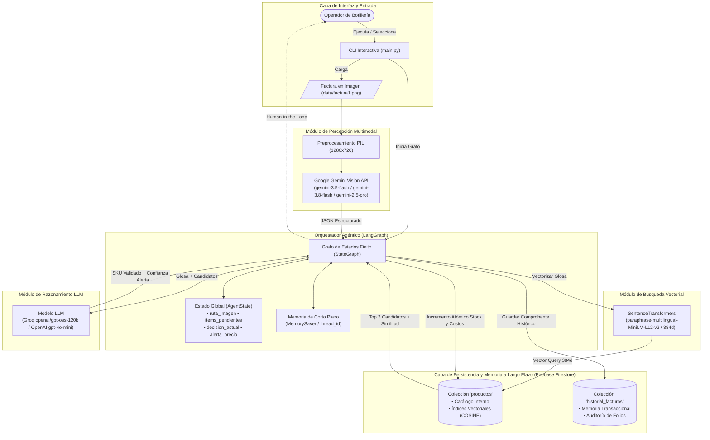
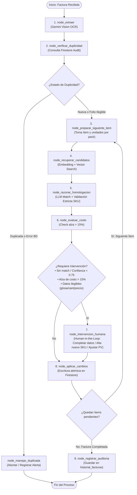

# Agente Inteligente de Homologación de Facturas e Inventario (Botillería)

Sistema agéntico autónomo desarrollado con **LangGraph**, **Google Gemini Vision**, **Firebase Firestore** y **SentenceTransformers** para automatizar la extracción multimodal, validación, homologación semántica y actualización de inventario a partir de facturas físicas y digitales de distribuidores de licores en Chile.

---

## 1. Problema de Negocio y Solución

En el rubro de las botillerías y comercializadoras de licores, las facturas emitidas por distribuidores mayoristas emplean glosas con abreviaturas comerciales informales (ej. `"mst 35 750"`, `"cerv cor 355 pack6"`, `"pis cap 30"`), empaques por bulto/pack, calibres variados y estructuras heterogéneas. La digitación manual de estas facturas genera altos costos operativos, lentitud en la reposición y errores en el stock y costos.

**Nuestra Solución:** Un **Agente Funcional con LangGraph** que orquesta herramientas de percepción multimodal, búsqueda semántica vectorial, razonamiento estructurado con LLM y persistencia en Firestore, con soporte para **memoria de corto y largo plazo** y un ciclo de **revisión humana supervisada (*Human-in-the-Loop*)** ante anomalías de precios, datos ilegibles o productos nuevos.

---

## 2. Arquitectura General del Sistema

El siguiente diagrama detalla la orquestación entre la interfaz de usuario, el orquestador LangGraph, los modelos de inteligencia artificial y la capa de almacenamiento en la nube:



---

## 3. Diagrama de Estados y Flujo de Decisión Adaptativa (LangGraph)

El flujo interno del agente se modela como un grafo cíclico con 10 nodos y 3 bordes condicionales que evalúan condiciones cambiantes del entorno:



---

## 4. Catálogo de Herramientas (*Agent Tools*) y Reglas de Validación

El agente dispone de **9 herramientas formales** construidas bajo el estándar `@tool` de LangChain:

| Tipo | Herramienta | Archivo Fuente | Descripción |
| :---: | :--- | :--- | :--- |
| **Consulta** | `extraer_factura_desde_imagen` | `src/tools/query_tools.py` | Extrae proveedor, folio e ítems (glosa, formato, cantidad, unidades por pack y precio) usando Gemini Vision. |
| **Consulta** | `consultar_duplicidad_factura` | `src/tools/query_tools.py` | Verifica en Firestore si el folio existe, diferenciando `VERIFICADA_NUEVA`, `DUPLICADA`, `FOLIO_ILEGIBLE` y `ERROR_CONSULTA`. |
| **Consulta** | `buscar_candidatos_vectoriales` | `src/tools/query_tools.py` | Búsqueda semántica (Top 3) mediante distancia coseno en Firestore, calculando `similitud_vectorial`. |
| **Consulta** | `consultar_producto_por_sku` | `src/tools/query_tools.py` | Inspecciona stock, costos y precios actuales de un producto en Firestore. |
| **Razonamiento** | `razonar_homologacion` | `src/tools/reasoning_tools.py` | Razona sobre abreviaturas comerciales, valida que el SKU pertenezca a los candidatos y calibra la confianza con la similitud vectorial. |
| **Razonamiento** | `evaluar_variacion_costo` | `src/tools/reasoning_tools.py` | Detecta aumentos abruptos de costo ($>15\%$) para sugerir ajustes al precio de venta. |
| **Escritura** | `actualizar_stock_y_costo` | `src/tools/write_tools.py` | Incrementa atómicamente el stock (`firestore.Increment` en transacción) considerando `cantidad * unidades` e idempotencia por folio. |
| **Escritura** | `registrar_nuevo_producto` | `src/tools/write_tools.py` | Da de alta un SKU nuevo generando su vector de 384 dimensiones de inmediato. |
| **Escritura** | `registrar_auditoria_factura` | `src/tools/write_tools.py` | Guarda el comprobante transaccional en la colección `historial_facturas`. |

### Controles de Robustez Implementados
* **Control de Duplicidad y Fallos de Consulta:** Si el folio no es legible en la imagen (`FOLIO_ILEGIBLE`), el agente continúa para procesar los productos; pero si ocurre un fallo de conexión o consulta en Firestore (`ERROR_CONSULTA`), aborta la ejecución de forma segura con estado `ERROR`.
* **Manejo de Datos Ilegibles (*Human-in-the-Loop*):** Si el nombre/glosa, la cantidad o el precio unitario de un ítem no son legibles en la factura (`null`), el borde condicional desvía automáticamente el ítem a `node_intervencion_humana` para que el operador complete el dato faltante o decida omitir el ítem.
* **Cálculo de Unidades por Pack y Verificación de Escritura:** El total de unidades a ingresar al inventario se calcula como `cantidad * unidades` (ej. 2 packs de 6 unidades suman 12 unidades al stock). Además, `node_aplicar_cambios` verifica `resultado["exito"]` antes de marcar un ítem como `AUTO_HOMOLOGADO`, `ACTUALIZADO` o `CREADO_NUEVO` (registrando `ERROR_ESCRITURA` si la operación falla).
* **Validación Estricta de Homologación:** Mediante el esquema Pydantic `ResultadoHomologacion` y `validar_respuesta_homologacion`, se comprueba que el `sku_seleccionado` pertenezca efectivamente a los candidatos recuperados de Firestore y se calibra la confianza del LLM ($70\%$) con la similitud vectorial coseno ($30\%$).

---

## 5. Estrategia de Memoria Dual

* **Memoria de Corto Plazo (Working Memory / Sesión):**
  * Implementada mediante `MemorySaver` de LangGraph (`langgraph.checkpoint.memory`).
  * Cada ejecución se indexa bajo un `thread_id` único, manteniendo trazabilidad del estado (`AgentState`) a lo largo de todos los nodos del ciclo.
* **Memoria de Largo Plazo (Persistencia en Firestore):**
  * **Semántica:** Colección `productos`, indexada con embeddings de 384 dimensiones generados por `SentenceTransformers` (`paraphrase-multilingual-MiniLM-L12-v2`).
  * **Transaccional / Episódica:** Colección `historial_facturas`, que registra cada factura procesada, fecha, proveedor, detalle de ítems y estado (`COMPLETADO` o `COMPLETADO_CON_ERRORES`).

---

## 6. Observabilidad y Trazabilidad (LangSmith)

El sistema cuenta con instrumentación nativa de **LangSmith**:
* Monitoreo en tiempo real de cada nodo del grafo, cadenas LCEL e invocaciones a herramientas.
* Auditoría de tokens consumidos, tiempos de respuesta (latencia) y mensajes generados.
* Proyecto configurado por defecto: `agente-facturas-botilleria`.

---

## 7. Instalación y Configuración

### 1. Requisitos Previos
* Python 3.10+.
* Proyecto activo en Google Firebase Firestore (con índice vectorial creado en la colección `productos` sobre el campo `embedding`, 384 dimensiones, distancia `COSINE`).
* Clave de API de Google Gemini (`GOOGLE_API_KEY`).
* Clave de API de Groq (`GROQ_API_KEY`) o de OpenAI (`OPENAI_API_KEY`).

### 2. Clonación e Instalación
```bash
git clone https://github.com/brayamandres/agente_facturas_botilleria_LangGraph.git
cd agente_facturas_botilleria_LangGraph
pip install -r requirements.txt
```

### 3. Configuración de Variables de Entorno (`.env`)
Crea un archivo `.env` en la raíz del proyecto con las siguientes variables:
```ini
# Credenciales Firebase (ruta al archivo JSON de cuenta de servicio)
FIREBASE_CREDENTIALS_PATH=firebase_credentials.json

# Credenciales LLM y Visión
GOOGLE_API_KEY=tu_google_api_key
GROQ_API_KEY=tu_groq_api_key
OPENAI_API_KEY=tu_openai_api_key

# Trazabilidad LangSmith (Opcional)
LANGSMITH_API_KEY=tu_langsmith_api_key
LANGCHAIN_PROJECT=agente-facturas-botilleria
```

Coloca tu archivo `.json` de credenciales de Firebase en la raíz del proyecto (está protegido por `.gitignore`, mientras que `src/services/seed_data.json` sí está versionado para sembrar el catálogo inicial).

---

## 8. Ejecución y Modo de Uso

Para iniciar el sistema desde la interfaz de línea de comandos (CLI):

```bash
python main.py
```

El menú interactivo dispone de **6 opciones**:
1. **Procesar una factura (Ejecutar Agente LangGraph):** Permite elegir cualquier factura disponible en `/data` y ejecutar el flujo completo del agente.
2. **Probar control de duplicados:** Re-procesa automáticamente la última factura procesada en la sesión (o permite seleccionar una si aún no se ha ejecutado la Opción 1) para demostrar el bloqueo adaptativo ante duplicados.
3. **Visualizar inventario en Firestore:** Lista los productos actuales del catálogo con su SKU, stock, costo y precio de venta.
4. **Consultar historial de auditoría:** Muestra las facturas registradas en la colección `historial_facturas`.
5. **Sembrar / Indexar catálogo inicial con Embeddings en Firestore:** Carga los 40 productos base desde `src/services/seed_data.json` calculando sus embeddings de 384 dimensiones.
6. **Salir:** Finaliza la aplicación.

---

## 9. Estructura del Proyecto

```text
agente_facturas_botilleria_LangGraph/
├── data/                           # Facturas en imagen (PNG / JPG)
│   ├── factura1.png                # Factura de prueba incluida en el repositorio
│   └── optimizado/                 # Imágenes redimensionadas automáticamente por PIL
├── src/
│   ├── __init__.py
│   ├── config.py                   # Variables de entorno, modelos IA y LangSmith
│   ├── agent/                      # Orquestador LangGraph
│   │   ├── __init__.py
│   │   ├── state.py                # Definición del Estado Tipado (AgentState)
│   │   └── graph.py                # Nodos, validaciones, bordes condicionales y MemorySaver
│   ├── services/                   # Clientes y conexiones externas
│   │   ├── __init__.py
│   │   ├── firebase.py             # Cliente Firestore Singleton y colecciones
│   │   ├── gemini.py               # Cliente Gemini Vision y preprocesamiento PIL
│   │   ├── llm.py                  # LLM para razonamiento (Groq / OpenAI)
│   │   ├── embeddings.py           # Modelo SentenceTransformers (384d)
│   │   ├── seed.py                 # Script de siembra e indexación vectorial
│   │   └── seed_data.json          # Catálogo inicial de 40 productos de botillería
│   └── tools/                      # Herramientas del agente (@tool)
│       ├── __init__.py
│       ├── query_tools.py          # Consulta (visión, duplicidad, búsqueda vectorial, SKU)
│       ├── reasoning_tools.py      # Razonamiento (homologación validada, variación de costo)
│       └── write_tools.py          # Escritura transaccional (stock atómico, alta SKU, auditoría)
├── main.py                         # Punto de entrada interactivo CLI (6 opciones)
├── requirements.txt                # Dependencias del proyecto
└── README.md                       # Documentación técnica del sistema
```
