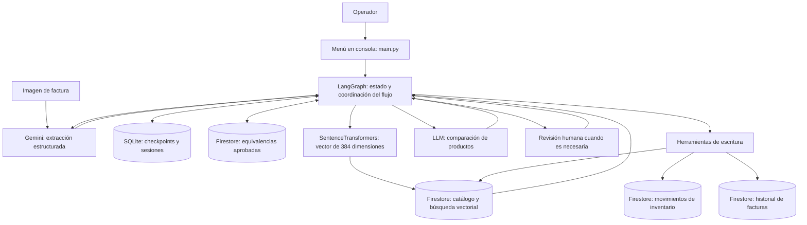
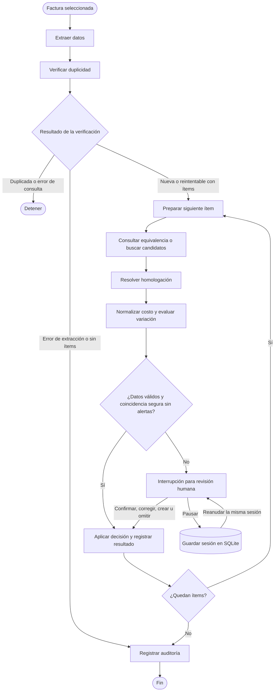

# Agente de facturas para botillería

Este proyecto ayuda a ingresar compras al inventario de una botillería a partir de imágenes de facturas. Busca resolver un problema habitual: los proveedores describen el mismo producto con nombres, abreviaturas y formatos distintos de los que usa el catálogo del negocio.

El agente lee la factura con Gemini, busca productos relacionados en Firestore y utiliza un modelo de lenguaje para proponer una equivalencia. Cuando la información es suficiente, actualiza el stock y el costo. Si encuentra una descripción dudosa, datos incompletos o un aumento de costo relevante, pide la intervención del operador.

La aplicación se maneja desde un menú en consola. Permite procesar facturas, revisar inventario e historial, y pausar una revisión para retomarla después.

## Cómo funciona

1. **Lee la imagen.** Extrae el proveedor, el folio y las líneas de productos. La respuesta se valida con esquemas Pydantic.
2. **Consulta el historial.** Si la factura ya está completada, detiene el procesamiento. Si tiene un registro previo con errores, recupera sus resultados para retomar las líneas pendientes de aplicación.
3. **Busca una equivalencia.** Primero consulta las asociaciones aprobadas para ese proveedor y esa glosa. Si no encuentra una, genera un embedding y recupera los tres candidatos más cercanos del catálogo.
4. **Evalúa la coincidencia.** Una equivalencia aprendida se reutiliza directamente. En los demás casos, el LLM compara la glosa y el formato con los candidatos disponibles.
5. **Revisa cantidades y costos.** Distingue precios por pack y por unidad, y compara el costo normalizado con el del catálogo.
6. **Aplica o solicita revisión.** Los casos claros se registran automáticamente. Los casos dudosos quedan a disposición del operador.
7. **Guarda el resultado.** Registra los movimientos de inventario y el estado de la factura en Firestore.

Por ejemplo, una compra de **2 packs de 6 botellas a \$12.000 por pack** debe sumar **12 botellas** al stock y registrar **$2.000 de costo por botella**.

## Arquitectura



LangGraph organiza los pasos y las rutas condicionales. LangChain aporta las herramientas declaradas con `@tool`, los prompts y la conexión con el modelo de razonamiento. La secuencia está definida en el código, el LLM interviene en la homologación de productos dentro de ese flujo.

Por su parte, Gemini se encarga de interpretar la imagen. SentenceTransformers genera los vectores para comparar descripciones. Firestore mantiene el catálogo, las equivalencias y los registros del negocio, mientras que SQLite conserva el avance de cada sesión en el equipo local.

### Herramientas disponibles

| Grupo | Herramientas | Uso |
| --- | --- | --- |
| Consulta | `extraer_factura_desde_imagen`, `consultar_duplicidad_factura` | Leer la factura y revisar su historial. |
| Consulta | `buscar_candidatos_vectoriales`, `consultar_producto_por_sku`, `consultar_equivalencia_proveedor` | Recuperar productos y asociaciones conocidas. |
| Razonamiento | `razonar_homologacion`, `evaluar_variacion_costo` | Comparar candidatos y detectar aumentos de costo. |
| Escritura | `actualizar_stock_y_costo`, `registrar_nuevo_producto` | Aplicar compras a productos existentes o registrar productos nuevos. |
| Escritura | `registrar_auditoria_factura`, `guardar_equivalencia_proveedor` | Conservar resultados y equivalencias aprobadas. |

### Decisiones durante el procesamiento

La política de decisión está en `src/agent/planning_policy.py`.

| Situación | Respuesta del agente |
| --- | --- |
| Factura ya completada o error al consultar duplicidad | Detiene las escrituras. |
| Glosa, cantidad o precio incompletos o inválidos | Solicita corrección al operador. |
| Producto identificado, datos válidos y sin alertas | Aplica el movimiento automáticamente. |
| Confianza menor a 0,75, solicitud de revisión, pack ambiguo o aumento de costo superior al 15 % | Solicita revisión humana. |
| Fallo al registrar un movimiento | Registra el error para permitir un reintento selectivo. |

Cuando se utiliza el LLM, el puntaje de confianza combina su estimación con la similitud vectorial: 70 % y 30 %, respectivamente, cuando la similitud está disponible en el rango admitido. Es una regla práctica para decidir cuándo revisar; no equivale a una probabilidad de acierto medida. Además, el SKU propuesto debe pertenecer a los candidatos recuperados.



## Memoria y continuidad

**Durante una factura**, `AgentState` conserva los datos extraídos, el ítem actual, los candidatos, las decisiones y los resultados acumulados. Los checkpoints se guardan en `data/checkpoints.sqlite`, asociados a un `thread_id`. El mismo archivo contiene el registro de sesiones usado por el menú de reanudación.

La revisión humana usa `interrupt()` de LangGraph. Si el operador pausa la tarea, puede cerrar la aplicación y volver a abrirla. Al elegir la sesión pendiente, el programa recupera el estado y continúa con `Command(resume=...)`. Para conservar esa continuidad se necesita mantener el archivo SQLite local.

**Entre facturas**, Firestore conserva cuatro colecciones:

| Colección | Información que conserva |
| --- | --- |
| `productos` | Catálogo, stock, costos, precios de venta y embeddings. |
| `equivalencias_proveedor` | Relación aprobada entre proveedor, glosa y SKU. |
| `movimientos_inventario` | Identidad y resultado de los movimientos aplicados por línea. |
| `historial_facturas` | Resultado de cada factura y detalle de sus líneas procesadas. |

Con el cliente real de Firestore, las herramientas de stock y alta de productos registran el producto y su movimiento dentro de una transacción. La identidad de operación utiliza proveedor, folio y número de línea para reconocer movimientos ya aplicados. Si el folio no es legible, se usa un respaldo basado en el nombre del archivo; en ese caso, la detección de duplicados tiene limitaciones.

Las equivalencias aprobadas por el operador se guardan para futuras compras del mismo proveedor. Así, una glosa ya conocida puede resolverse sin volver a consultar al LLM, aunque sigue pasando por la revisión de datos y costos.

## Instalación

Se necesita Python 3.10 o superior, acceso a internet y un proyecto de Firebase con Firestore habilitado. La revisión local se realizó con Python 3.12.

Desde la raíz del repositorio, en PowerShell:

```powershell
python -m venv .venv
.\.venv\Scripts\python.exe -m pip install -r requirements.txt
Copy-Item .env.example .env
```

Edita `.env` con tus credenciales:

```dotenv
#Credenciales Firebase
FIREBASE_CREDENTIALS_PATH=path_al_json

#Credenciales Google
GOOGLE_API_KEY=google_api_key

#Credenciales de Groq
GROQ_API_KEY=groq_api_key

#Credenciales OpenAI
#OPENAI_API_KEY=openai_api_key

#Credenciales LangSmith
LANGSMITH_API_KEY=langsmith_api_key
```

`FIREBASE_CREDENTIALS_PATH` debe apuntar al JSON de una cuenta de servicio con permisos sobre Firestore. Puede ser una ruta absoluta o relativa a la raíz del proyecto. Las credenciales y `.env` están excluidos por `.gitignore`.

Para el razonamiento basta con configurar **Groq u OpenAI**. Si ambas claves están presentes, el código elige Groq, esto es seleccionado en el código, por lo que si se quiere ocupar OpenAI, hay que realizar cambios.

Los nombres de los modelos están en `src/config.py` y `src/services/llm.py`. Gemini intenta los modelos de su lista en orden hasta conseguir una extracción válida, esto se debe a que se realiza mediante un free tier. Sin embargo si se tiene la api pagada no debería intentar uno por uno con los distintos modelos.
### Preparar el catálogo

1. Inicia la aplicación y utiliza la opción **6** para cargar el catálogo de `src/services/seed_data.json`, que contiene 40 productos. La primera generación de embeddings puede necesitar descargar el modelo de SentenceTransformers.
2. Crea en Firestore el índice vectorial de la colección `productos`, sobre el campo `embedding`, con **384 dimensiones**. Las consultas del proyecto usan distancia **COSINE**. La siembra guarda los vectores, pero no crea el índice.
3. Confirma que el catálogo se puede consultar con la opción **4** antes de procesar una factura.

La configuración del índice se explica en la [documentación de búsqueda vectorial de Firestore](https://firebase.google.com/docs/firestore/vector-search). Si la consulta devuelve un error de índice faltante, sigue las indicaciones del servicio y espera a que el índice esté disponible.

La siembra también puede ejecutarse desde la raíz con:

```powershell
.\.venv\Scripts\python.exe -m src.services.seed
```

Los productos que ya tienen embedding se omiten por defecto. Cuando la siembra escribe un producto, también utiliza los valores de stock y precios del catálogo inicial; conviene tenerlo presente si se trabaja con una base que ya contiene movimientos.

## Uso

```powershell
.\.venv\Scripts\python.exe main.py
```

Agrega las imágenes de facturas a `data/`. El selector del menú reconoce archivos `.png`, `.jpg` y `.jpeg`. La entrada del agente es una imagen; el menú no procesa facturas en PDF directamente.

| Opción | Qué permite hacer |
| --- | --- |
| 1. Procesar una factura nueva | Seleccionar una imagen y ejecutar el agente. |
| 2. Reanudar factura pendiente | Recuperar una sesión guardada y continuar la revisión. |
| 3. Probar control de duplicados | Volver a procesar la última factura de la sesión o seleccionar otra. |
| 4. Visualizar inventario | Consultar productos, stock, costo y precio de venta. |
| 5. Consultar historial de auditoría | Ver las facturas registradas y sus estados. |
| 6. Sembrar / indexar catálogo inicial | Cargar los productos iniciales y sus embeddings. |
| 7. Salir | Cerrar la aplicación. |

Durante una revisión puedes confirmar un candidato, buscar otro SKU existente, crear un producto o dejar el ítem omitido. También puedes usar `p` para pausar la sesión. Las correcciones se solicitan en consola antes de aplicar la decisión.

El historial distingue resultados como `COMPLETADO`, `COMPLETADO_CON_ERRORES`, `PARCIAL`, `PENDIENTE_REVISION` y `ERROR_EXTRACCION`. El detalle por línea permite revisar qué se aplicó y qué requiere atención.

### Trazas opcionales

Para activar LangSmith, configura una clave válida y cambia `LANGCHAIN_TRACING_V2=true` en `.env`. Sin esa combinación, `src/config.py` desactiva el tracing. Las trazas de las invocaciones instrumentadas se consultan en el proyecto indicado por `LANGCHAIN_PROJECT`.

## Escenarios para comprobar el funcionamiento

Estos pasos son una guía de comprobación manual. No representan pruebas automatizadas ni resultados ya obtenidos con servicios reales.

| Escenario | Cómo comprobarlo | Qué revisar |
| --- | --- | --- |
| Compra reconocida | Procesar una factura con productos identificables y costos habituales. | SKU asignado, unidades ingresadas y auditoría. |
| Factura duplicada | Repetir una factura completada mediante la opción 3. | Que el stock no vuelva a incrementarse. |
| Descripción dudosa | Usar una glosa ambigua o un producto sin coincidencia clara. | Que se solicite revisión antes de escribir. |
| Cambio de costo | Usar un costo unitario más de 15 % superior al del catálogo. | Que aparezca la alerta y se solicite confirmación. |
| Pausa y continuidad | Pausar con `p`, cerrar el programa y reabrirlo con la opción 2. | Que se conserve el avance y continúe el ítem pendiente. |
| Equivalencia aprendida | Confirmar una glosa y usarla en otra factura del mismo proveedor con un folio nuevo. | Que se recupere la equivalencia aprobada. |
| Compra por pack | Usar cantidad, unidades por pack y tipo de precio conocidos. | Que stock y costo se calculen por unidad individual. |

Para conservar evidencia, registra los datos de entrada, el inventario antes y después, la salida de consola y el resultado de la auditoría.

## Estructura del proyecto

```text
.
├── main.py                         # Menú y ejecución de sesiones
├── requirements.txt                # Dependencias
├── .env.example                    # Variables de configuración de ejemplo
├── data/                           # Imágenes y SQLite local generado al ejecutar
├── src/
│   ├── config.py                   # Rutas, modelos y configuración
│   ├── agent/
│   │   ├── state.py                # Estado compartido entre nodos
│   │   ├── graph.py                # Flujo, revisión humana y rutas condicionales
│   │   └── planning_policy.py      # Reglas de decisión por prioridad
│   ├── services/
│   │   ├── checkpointer.py         # Checkpoints SQLite y registro de sesiones
│   │   ├── firebase.py             # Cliente y colecciones de Firestore
│   │   ├── gemini.py               # Lectura de imágenes y validación de extracción
│   │   ├── llm.py                  # Modelo de razonamiento
│   │   ├── embeddings.py           # Generación de vectores
│   │   ├── seed.py                 # Carga del catálogo inicial
│   │   └── seed_data.json          # Datos de los 40 productos iniciales
│   └── tools/
│       ├── query_tools.py          # Herramientas de consulta
│       ├── reasoning_tools.py      # Homologación y análisis de costos
│       └── write_tools.py          # Inventario, auditoría y equivalencias
└── firestore_products.ipynb        # Cuaderno de carga y consulta del catálogo
```

## Referencias

Google. (s. f.). *[Image understanding](https://ai.google.dev/gemini-api/docs/image-understanding)*. Google AI for Developers.

Google. (s. f.). *[Search with vector embeddings](https://firebase.google.com/docs/firestore/vector-search)*. Firebase.

LangChain. (s. f.-a). *[LangGraph overview](https://docs.langchain.com/oss/python/langgraph/overview)*.

LangChain. (s. f.-b). *[Persistence](https://docs.langchain.com/oss/python/langgraph/persistence)*.