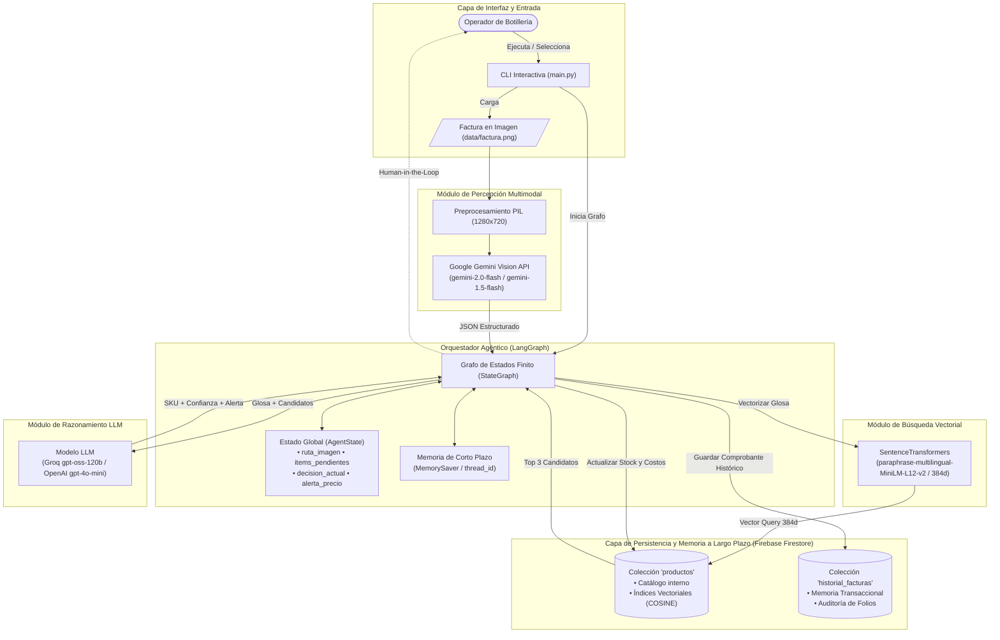
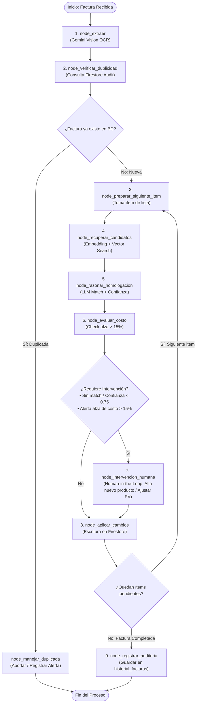

# Proyecto de gestor de inventario para botillería
Se implementa un agente de automatización de inventario para una botillería. El flujo completo abarca:
1. **Extracción Multimodal con Gemini**: Lectura visual de la factura emitida por el distribuidor de licores para extraer proveedor, folio e ítems en formato JSON estructurado.
2. **Búsqueda Vectorial Semántica en Firestore**: Generación de embeddings con *SentenceTransformers* y recuperación de los productos más similares del catálogo interno mediante `find_nearest()`.
3. **Homologación con LangChain y LLM**: Razonamiento para mapear abreviaciones comerciales y formatos al SKU correspondiente de la base de datos.
4. **Trazabilidad con LangSmith**: Monitoreo y auditoría de cada paso y prompt ejecutado por el LLM.
# Agente Inteligente de Homologación de Facturas e Inventario (Botillería)

## Uso del repositorio
1. Clonar repositorio.
2. Duplicar `.env.example`, renombrar a `.env` y añadir las credenciales necesarias. Las credenciales `.json de Firebase` deben ir en la **raiz del proyecto**.
3. Instalar dependencias necesarias `requirements.txt`.
4. En la raiz del proyecto, crear carpeta `data`. Luego dentro de data (`/data`) añadir las facturas en formato imagen.
5. Ejecutar el cuaderno `agente_factura.ipynb`. Luego, en el código de `4. Preprocesamiento de la Factura (Imagen)` se solicitará ingresar el número de la factura.
Sistema agéntico autónomo desarrollado con **LangGraph**, **Google Gemini Vision**, **Firebase Firestore** y **SentenceTransformers** para automatizar la extracción, validación, homologación semántica y actualización de inventario a partir de facturas físicas y digitales de distribuidores de licores en Chile.

---

## 1. Problema de Negocio y Solución

En el rubro de las botillerías y comercializadoras de licores, las facturas emitidas por distribuidores mayoristas emplean glosas con abreviaturas comerciales informales (ej. `"mst 35 750"`, `"cerv cor 355 pack6"`, `"pis cap 30"`), calibres variados y estructuras heterogéneas. La digitación manual de estas facturas genera altos costos operativos, lentitud en la reposición y errores en el stock y costos.

**Nuestra Solución:** Un **Agente Funcional con LangGraph** que orquesta herramientas de percepción multimodal, búsqueda semántica vectorial, razonamiento con LLM y persistencia transaccional, con soporte para **memoria de corto y largo plazo** y un ciclo de **revisión humana supervisada (*Human-in-the-Loop*)** ante anomalías de precios o productos nuevos.

---

## 2. Arquitectura General del Sistema

El siguiente diagrama detalla la orquestación entre la interfaz de usuario, el orquestador LangGraph, los modelos de inteligencia artificial y la capa de almacenamiento en la nube:



---

## 3. Diagrama de Estados y Flujo de Decisión Adaptativa (LangGraph)

El flujo interno del agente se modela como un grafo cíclico con 10 nodos y 3 bordes condicionales que evalúan condiciones cambiantes del entorno:



---

## 4. Catálogo de Herramientas (*Agent Tools* - Criterio IE1)

El agente dispone de **9 herramientas formales** construidas bajo el estándar `@tool` de LangChain:

| Tipo | Herramienta | Archivo Fuente | Descripción |
| :---: | :--- | :--- | :--- |
| **Consulta** | `extraer_factura_desde_imagen` | `src/tools/query_tools.py` | Extrae folio, proveedor e ítems detallados usando visión multimodal de Gemini. |
| **Consulta** | `consultar_duplicidad_factura` | `src/tools/query_tools.py` | Verifica en Firestore si el folio y proveedor ya fueron procesados previamente. |
| **Consulta** | `buscar_candidatos_vectoriales` | `src/tools/query_tools.py` | Búsqueda semántica (Top 3) mediante distancia de coseno en el catálogo vectorial. |
| **Consulta** | `consultar_producto_por_sku` | `src/tools/query_tools.py` | Inspecciona stock, costos y precios actuales de un producto en Firestore. |
| **Razonamiento** | `razonar_homologacion` | `src/tools/reasoning_tools.py` | Razona sobre abreviaturas de licores chilenos y asigna SKU con nivel de confianza. |
| **Razonamiento** | `evaluar_variacion_costo` | `src/tools/reasoning_tools.py` | Detecta aumentos abruptos de costo ($>15\%$) para sugerir ajustes al precio de venta. |
| **Escritura** | `actualizar_stock_y_costo` | `src/tools/write_tools.py` | Actualiza atómicamente el stock sumando unidades y ajusta costos en Firestore. |
| **Escritura** | `registrar_nuevo_producto` | `src/tools/write_tools.py` | Da de alta un SKU nuevo generando su vector de 384 dimensiones de inmediato. |
| **Escritura** | `registrar_auditoria_factura` | `src/tools/write_tools.py` | Guarda el comprobante transaccional en la colección `historial_facturas`. |

---

## 5. Estrategia de Memoria Dual (Criterios IE3 e IE4)

* **Memoria de Corto Plazo (Working Memory / Sesión):**
  * Implementada mediante `MemorySaver` de LangGraph (`langgraph.checkpoint.memory`).
  * Cada ejecución se indexa bajo un `thread_id` único. Permite congelar el estado del agente durante la interacción *Human-in-the-Loop* y reanudar la ejecución sin perder variables de contexto ni re-ejecutar llamadas de visión costosas.
* **Memoria de Largo Plazo (Persistencia en Firestore):**
  * **Semántica:** Colección `productos`, indexada con embeddings de 384 dimensiones generados por `SentenceTransformers`. El agente recuerda productos, marcas y formatos en el tiempo.
  * **Transaccional / Episódica:** Colección `historial_facturas`, que registra cada factura procesada, fecha, proveedor y total de ítems, permitiendo bloquear duplicados y auditar compras pasadas.

---

## 6. Observabilidad y Trazabilidad (LangSmith)

El sistema cuenta con instrumentación nativa de **LangSmith**:
* Monitoreo en tiempo real de cada nodo del grafo, cadenas LCEL e invocaciones a herramientas.
* Auditoría de tokens consumidos, tiempos de respuesta (latencia) y mensajes generados.
* Proyecto configurado: `agente-facturas-botilleria`.

---

## 7. Instalación y Configuración

### 1. Requisitos Previos
* Python.
* Cuenta y proyecto activo en Google Firebase Firestore.
* Clave de API de Google Gemini (`GOOGLE_API_KEY`).
* Clave de API de Groq (`GROQ_API_KEY`) o de OpenAI (`OPENAI_API_KEY`).

### 2. Clonación e Instalación
```bash
git clone https://github.com/brayamandres/agente_facturas_botilleria.git
cd agente_facturas_botilleria
pip install -r requirements.txt
```

### 3. Configuración de Variables de Entorno (`.env`)
Duplica el archivo `.env.example` y renómbralo a `.env`:
```ini
# Credenciales Firebase
FIREBASE_CREDENTIALS_PATH=firebase_credentials.json

# Credenciales LLM y Visión
GOOGLE_API_KEY=tu_google_api_key
GROQ_API_KEY=tu_groq_api_key
OPENAI_API_KEY=tu_openai_api_key

# Trazabilidad LangSmith (Opcional)
LANGSMITH_API_KEY=tu_langsmith_api_key
LANGCHAIN_PROJECT=agente-facturas-botilleria
```

Coloca el archivo de credenciales de Firebase (`.json`) en la raíz del proyecto.

---

## 8. Ejecución y Modo de Uso

Para iniciar el sistema con interfaz de línea de comandos (CLI):

```bash
python main.py
```

El menú interactivo te permite:
1. **Procesar una factura:** Ejecuta el grafo completo sobre una imagen de `/data`.
2. **Probar control de duplicados:** Re-procesa la misma factura para demostrar la toma de decisiones adaptativa.
3. **Visualizar inventario:** Inspecciona los productos y stock actuales en Firestore.
4. **Consultar auditoría:** Revisa las facturas guardadas en la memoria histórica.

---

## 9. Estructura del Proyecto

```text
agente_facturas_botilleria/
├── data/                       # Facturas en imagen (PNG / JPG)
│   ├── factura1.png            # Factura de prueba de distribuidor
│   └── optimizado/             # Imágenes redimensionadas por PIL
├── documentos/                 # Pautas e instrucciones académicas
├── src/
│   ├── config.py               # Variables de entorno y configuración LangSmith
│   ├── agent/                  # Orquestador LangGraph
│   │   ├── state.py            # Definición del Estado Tipado (AgentState)
│   │   └── graph.py            # Nodos, Bordes Condicionales y Checkpointer
│   ├── services/               # Conexiones externas e integraciones
│   │   ├── firebase.py         # Cliente Firestore y referencias de colecciones
│   │   ├── gemini.py           # Cliente Gemini Vision y optimización de imagen
│   │   ├── llm.py              # LLM para razonamiento (Groq / OpenAI)
│   │   └── embeddings.py       # Modelo SentenceTransformers (384d)
│   └── tools/                  # Herramientas del agente (@tool)
│       ├── query_tools.py      # Consulta (visión, duplicidad, vector search)
│       ├── reasoning_tools.py  # Razonamiento (homologación, variación costos)
│       └── write_tools.py      # Escritura (stock, nuevos productos, auditoría)
├── main.py                     # Punto de entrada interactivo CLI
├── requirements.txt            # Dependencias del proyecto
└── README.md                   # Documentación técnica completa
```